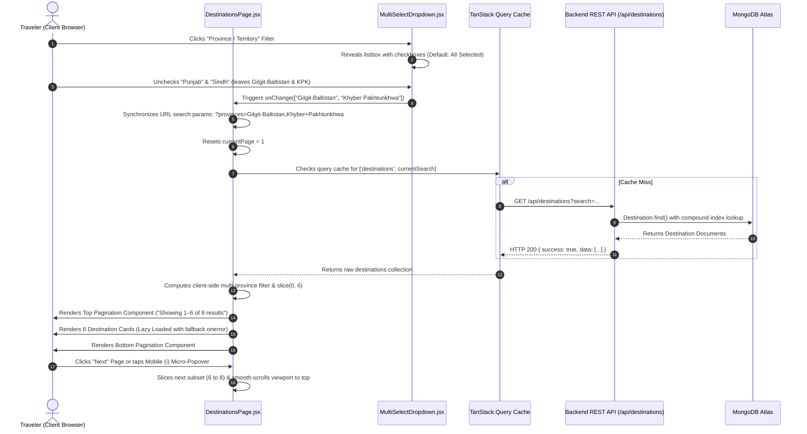
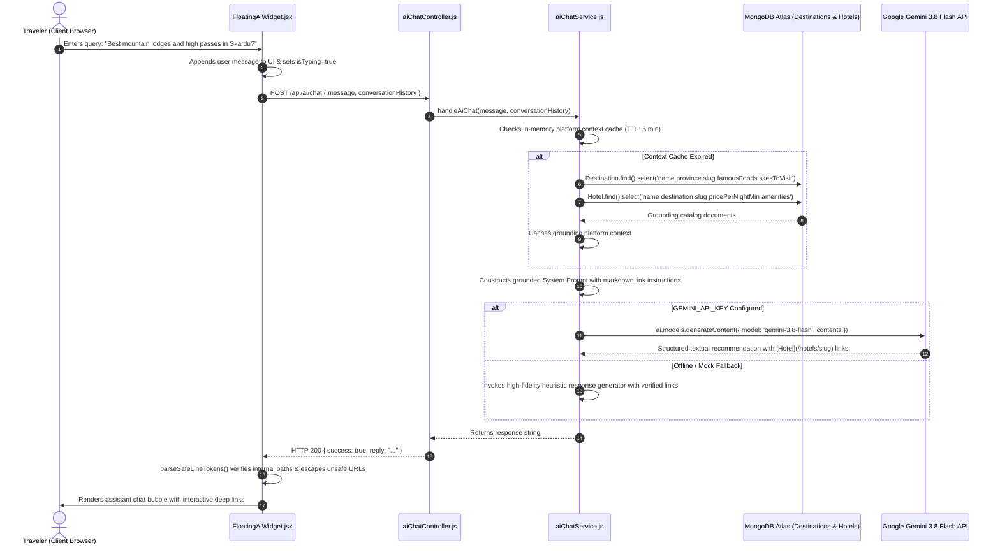
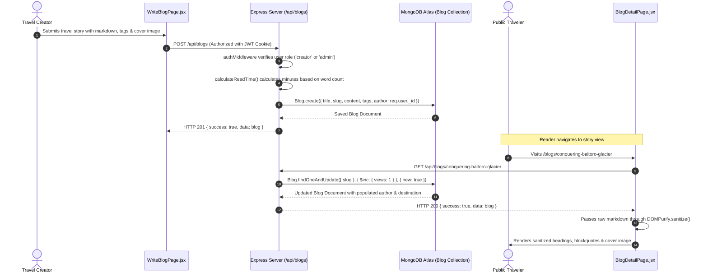
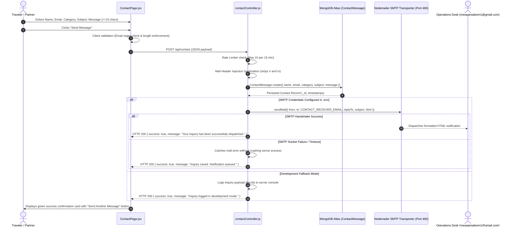

# Academic Reference Manual & Architectural Defense Guide
## Project: `myjourney.pk` — Full-Stack MERN Tourism Ecosystem for Pakistan
**Course:** Advanced Web Engineering & Human-Computer Interaction (HCI)  
**Branch:** `feat/ui-hardening-and-academic-readiness`  
**Target Audience:** Evaluation Committee, Academic Defense Panels, and Software Architects  

---

## 1. Monorepo Architecture & Technology Stack

`myjourney.pk` is architected as an enterprise-grade decoupled monorepo adhering strictly to modern ECMAScript Modules (`import`/`export`) across both client and server boundaries.

```
myjourney.pk/
├── client/                               # Single-Page Application (SPA) Frontend
│   ├── public/
│   │   ├── favicon.svg                   # Production Emerald Tourism Crest SVG Favicon
│   │   └── icons.svg
│   ├── src/
│   │   ├── api/
│   │   │   └── axios.js                  # Axios HTTP client withCredentials & base configuration
│   │   ├── components/
│   │   │   ├── ai/
│   │   │   │   └── FloatingAiWidget.jsx  # Floating conversational AI concierge drawer
│   │   │   ├── auth/
│   │   │   │   └── ProtectedRoute.jsx    # RBAC declarative route guard
│   │   │   ├── common/
│   │   │   │   ├── BackToTop.jsx         # Passive scroll-monitored floating back-to-top FAB
│   │   │   │   ├── MultiSelectDropdown.jsx# WAI-ARIA accessible multi-select filter dropdown
│   │   │   │   └── Pagination.jsx        # Dual-responsive pagination with micro-popover
│   │   │   └── layout/
│   │   │       ├── Footer.jsx            # Semantic 4-column directory footer with guide links
│   │   │       ├── MainLayout.jsx        # SPA shell with sticky nav & floating widgets
│   │   │       └── Navbar.jsx            # Responsive header with scroll-locked mobile drawer
│   │   ├── context/
│   │   │   └── AuthContext.jsx           # Global session state & cookie synchronization
│   │   ├── hooks/
│   │   │   └── useAuth.js                # Custom authentication consumer hook
│   │   ├── pages/
│   │   │   ├── BlogDetailPage.jsx        # Narrative view with DOMPurify XSS sanitization
│   │   │   ├── BlogsPage.jsx             # Travelogue directory with multi-tag filtering
│   │   │   ├── BookmarksPage.jsx         # User saved destinations and hotel stays
│   │   │   ├── ContactPage.jsx           # Categorized contact inquiry with TanStack mutation
│   │   │   ├── DestinationDetailPage.jsx # Rich destination guide with attractions & cuisines
│   │   │   ├── DestinationsPage.jsx      # Multi-province faceted destination browser
│   │   │   ├── EcoTrekking.jsx           # Leave No Trace & environmental conservation guide
│   │   │   ├── HomePage.jsx              # Landing portal with hero search & featured hubs
│   │   │   ├── HotelDetailPage.jsx       # Room tier booking and amenities inspector
│   │   │   ├── HotelsPage.jsx            # Multi-faceted hotel directory & price filtering
│   │   │   ├── LocalEtiquette.jsx        # Cultural dress codes & antiquities protection
│   │   │   ├── LoginPage.jsx             # Controlled credential login form
│   │   │   ├── MyPlansPage.jsx           # Saved itineraries & reservation ledger
│   │   │   ├── NotFoundPage.jsx          # Accessible 404 fallback
│   │   │   ├── PlannerPage.jsx           # AI-powered interactive itinerary architect
│   │   │   ├── RegisterPage.jsx          # HCI-polished user registration form
│   │   │   ├── SafetyGuidelines.jsx      # Emergency 1122 helplines & hazard precautions
│   │   │   ├── TravelAdvisory.jsx        # Road conditions, Babusar passes & acclimatization
│   │   │   └── WriteBlogPage.jsx         # Creator travelogue authoring studio
│   │   ├── App.jsx                       # Master React Router v6/v7 route declaration tree
│   │   └── main.jsx                      # React 19 DOM root & TanStack QueryProvider
│   ├── index.html                        # HTML5 document root with SEO meta & SVG favicon
│   ├── package.json                      # React 19, Tailwind v3, TanStack Query, Lucide
│   └── vite.config.js                    # Vite bundler build config
│
├── server/                               # Node.js Express REST API Backend
│   ├── src/
│   │   ├── config/
│   │   │   └── db.js                     # Resilient Mongoose connection (IPv4 forced, fail-fast)
│   │   ├── controllers/
│   │   │   ├── aiChatController.js       # Grounded conversational agent handler
│   │   │   ├── authController.js         # JWT auth, bcrypt hashing, TLS crash protection
│   │   │   ├── blogController.js         # Travelogue CRUD, view increment, like toggles
│   │   │   ├── bookingController.js      # Hotel reservation lifecycle & capacity checks
│   │   │   ├── bookmarkController.js     # User bookmark toggles for destinations/hotels
│   │   │   ├── contactController.js      # Nodemailer SMTP dispatch & header sanitization
│   │   │   ├── destinationController.js  # Geo-directory CRUD & keyword regex search
│   │   │   ├── hotelController.js        # Hotel listings, amenities & nightly rate filter
│   │   │   ├── itineraryController.js    # Multi-day AI itinerary generation pipeline
│   │   │   └── reviewController.js       # Star ratings & verified reviews aggregation
│   │   ├── middleware/
│   │   │   └── authMiddleware.js         # JWT cookie verification & RBAC authorization
│   │   ├── models/
│   │   │   ├── Blog.js                   # Mongoose schema with readTime calculation
│   │   │   ├── Booking.js                # Reservation schema with status state machines
│   │   │   ├── ContactMessage.js         # Inquiry schema with categories & audit flags
│   │   │   ├── Destination.js            # Destination schema with co-located sites & food
│   │   │   ├── Hotel.js                  # Accommodations schema with room tiers
│   │   │   ├── Itinerary.js              # Saved AI trip plan schema
│   │   │   ├── Review.js                 # Rating schema with destination recalculation
│   │   │   └── User.js                   # User schema with salted bcrypt pre-save hooks
│   │   ├── routes/
│   │   │   ├── aiChatRoutes.js           # Express router for AI chat
│   │   │   ├── authRoutes.js             # Express router for authentication
│   │   │   ├── blogRoutes.js             # Express router for travel stories
│   │   │   ├── bookingRoutes.js          # Express router for bookings
│   │   │   ├── bookmarkRoutes.js         # Express router for bookmarks
│   │   │   ├── contactRoutes.js          # Express router for contact form
│   │   │   ├── destinationRoutes.js      # Express router for destinations
│   │   │   ├── hotelRoutes.js            # Express router for hotels
│   │   │   ├── itineraryRoutes.js        # Express router for itinerary planner
│   │   │   └── reviewRoutes.js           # Express router for reviews
│   │   ├── services/
│   │   │   ├── aiChatService.js          # Google Gemini 3.8 Flash SDK grounding service
│   │   │   └── aiPlannerService.js       # Structured JSON itinerary generation service
│   │   ├── utils/
│   │   │   ├── generateToken.js          # JWT signing with HTTP-only SameSite cookie
│   │   │   ├── seedBlogs.js              # Initial database seed for travelogues
│   │   │   └── seedDestinations.js       # Initial database seed for destinations & hotels
│   │   └── index.js                      # Application bootstrap, Helmet, NoSQL sanitize, rate limit
│   ├── .env                              # Active environment configuration
│   ├── .env.example                      # Production environment template
│   └── package.json                      # Express, Mongoose, Nodemailer, Helmet, GenAI
│
└── reference.md                          # Academic Evaluation Artifact & Architectural Manual
```

---

## 2. Academic Concepts vs. Implementation Mapping

The following comprehensive matrix maps fundamental web engineering, cybersecurity, and HCI academic principles to their exact source implementations within `myjourney.pk`:

| Academic / Web Concept | Implementation Files | Mechanism & How It Works in myjourney.pk |
|---|---|---|
| **NoSQL Injection Defense** | `server/src/index.js` (Lines 77–93) | Attackers inject query operator keys (`$gt`, `$ne`, `$regex`, or `.` path traversal) inside JSON request bodies to bypass boolean evaluations (e.g., bypassing passwords with `{ "email": { "$ne": null } }`). In Express 5, `req.query` is configured with a getter-only property descriptor on `IncomingMessage.prototype`, causing default middleware wrappers to throw `Cannot set property query which has only a getter`. Our architecture executes `mongoSanitize.sanitize` directly on `req.body`, `req.params`, and `req.query`, mutating keys in-place and neutralizing operators before requests reach Mongoose models. |
| **Cross-Site Scripting (XSS) Prevention** | `server/src/index.js` (Lines 48–54)<br>`client/src/pages/BlogDetailPage.jsx` (Lines 117–182)<br>`server/src/utils/generateToken.js` (Lines 33–38) | **Defense-in-Depth:**<br>1. **HTTP Security Headers:** `helmet` sets `X-Content-Type-Options: nosniff` (stopping MIME-sniffing script execution) and `X-Frame-Options: SAMEORIGIN` (blocking iframe clickjacking).<br>2. **Output Sanitization:** In `BlogDetailPage.jsx`, user-authored travelogue markdown is processed through `DOMPurify.sanitize()`, removing `<script>`, `onerror`, `onload`, and `javascript:` pseudo-protocols before emitting HTML nodes.<br>3. **Storage Boundary:** JWT authentication tokens are placed exclusively in `httpOnly: true` cookies, making them strictly inaccessible to `document.cookie` in the event of any client-side JavaScript injection. |
| **CSRF & SameSite Cookie Architecture** | `server/src/utils/generateToken.js` (Lines 33–39)<br>`server/src/controllers/authController.js` (Lines 152–158) | Cross-Site Request Forgery (CSRF) tricks a user's browser into sending authenticated requests to a target origin without their consent. `myjourney.pk` neutralizes CSRF via two complementary mechanisms:<br>1. **`SameSite: 'lax'` Cookie Policy:** The browser automatically refuses to attach the `token` cookie to cross-site state-changing subresource requests (e.g., unauthorized POST forms or script fetches originating from an external malicious domain).<br>2. **JSON Content-Type Gate:** All mutating endpoints require `Content-Type: application/json`. Standard HTML cross-origin forms can only emit `application/x-www-form-urlencoded`, `multipart/form-data`, or `text/plain`. Emitting JSON triggers a CORS preflight `OPTIONS` handshake that fails against unauthorized origins. |
| **Same-Origin Policy (SOP) & CORS** | `server/src/index.js` (Lines 56–66) | Under browser SOP, web pages cannot make arbitrary cross-origin XMLHttpRequests. `corsOptions` explicitly restricts cross-origin communication to `process.env.CLIENT_URL` (`http://localhost:5173`). Wildcards (`*`) are disallowed because `credentials: true` is enforced. This ensures third-party domains cannot read user session responses or exfiltrate private bookmark/itinerary data. |
| **JWT Authentication & Role-Based Access Control (RBAC)** | `server/src/utils/generateToken.js` (Lines 18–41)<br>`server/src/middleware/authMiddleware.js` (Lines 18–85)<br>`client/src/components/auth/ProtectedRoute.jsx` (Lines 15–40) | 1. **Token Generation:** When a user logs in or registers, `generateToken` signs an HMAC SHA-256 JWT containing minimal payload: `{ id: user._id, role: user.role }`.<br>2. **Backend Guarding:** `protect` middleware verifies token integrity and extracts the User document; `authorize('creator', 'admin')` restricts write operations (e.g., `POST /api/blogs`) based on user role.<br>3. **Frontend Guarding:** `<ProtectedRoute allowedRoles={['creator', 'admin']}>` redirects unauthenticated or unauthorized users, preserving navigation intent. |
| **Input Sanitization & Output Escaping** | `server/src/controllers/contactController.js` (Lines 63–76)<br>`server/src/controllers/destinationController.js` (Lines 41–48)<br>`client/src/components/ai/FloatingAiWidget.jsx` (Lines 28–88) | 1. **Mail Header Injection:** In `contactController.js`, regex strips `\r` and `\n` characters from `name` and `subject` fields, preventing attackers from injecting arbitrary SMTP headers (`Bcc:`, `Cc:`).<br>2. **Regex Query Escaping:** In `destinationController.js`, search terms escape special regex symbols `/[.*+?^${}()|[\]\\]/g` to prevent Regex Denial of Service (ReDoS) or unintended wildcard matches.<br>3. **Tokenized Text Parsing:** In `FloatingAiWidget.jsx`, incoming markdown links are validated: only paths beginning with `/` are rendered via React Router `<Link>`, neutralising malicious `javascript:` schemes. |
| **Database Indexing & Mongoose Aggregation** | `server/src/models/Destination.js` (Compound & text indices)<br>`server/src/models/Hotel.js`<br>`server/src/controllers/reviewController.js` | 1. **Compound Indexing:** Destination and Hotel collections maintain compound indexes on `{ province: 1, averageRating: -1 }` and `{ destination: 1, pricePerNightMin: 1 }`, speeding filter lookups from $O(N)$ full table scans to $O(\log N)$ B-tree index traversals.<br>2. **Aggregation Pipelines:** When a user submits a star review, Mongoose runs an aggregate pipeline: `$match` destination ID $\to$ `$group` by destination calculating `$avg: "$rating"` and `$sum: 1` $\to$ atomically updates the parent destination document's `averageRating` and `reviewCount`. |
| **HCI & Progressive Disclosure** | `client/src/components/common/MultiSelectDropdown.jsx`<br>`client/src/components/common/Pagination.jsx`<br>`client/src/pages/RegisterPage.jsx` | 1. **Progressive Disclosure:** Replaces 8 sprawling province buttons with an encapsulated dropdown that reveals checkboxes on demand and displays contextual counts ("Provinces (3)").<br>2. **Show, Don't Tell (Mobile Popover):** On mobile viewports (<640px), pagination displays compact controls (`Page 1 of 5`) with a Lucide `Info` (`i`) icon that toggles a micro-popover displaying "Showing 1–6 of 24 results", preserving screen real estate without losing system status visibility.<br>3. **Typographic Polish:** Replaced all-caps form labels with Sentence Case and added red asterisks (`*`) on required fields, respecting Fitts' Law and cognitive visual processing. |
| **Responsive Mobile-First Design & Layout Shifts (CLS)** | `client/src/components/layout/Navbar.jsx`<br>`client/src/components/common/BackToTop.jsx`<br>Across all `` tags | 1. **Scroll-Chaining Prevention:** When mobile drawer menu is opened, `document.body.style.overflow = 'hidden'` prevents background page scroll bleed, with cleanup on unmount.<br>2. **Cumulative Layout Shift (CLS) Mitigation:** All image elements define explicit aspect ratios, `loading="lazy"`, `decoding="async"`, and fallback placeholder onerror handlers to prevent layout shifts when high-res assets load asynchronously.<br>3. **Ergonomic FAB Placement:** Back-to-top button is pinned directly above the AI Guide widget (`bottom-20 right-6 z-40`), using passive scroll monitoring (`{ passive: true }`) to maintain 60fps scrolling. |
| **Asynchronous State & Cache Invalidation** | `client/src/pages/DestinationsPage.jsx`<br>`client/src/pages/HotelsPage.jsx`<br>`client/src/pages/BlogDetailPage.jsx`<br>`client/src/pages/ContactPage.jsx` | Uses TanStack Query (`@tanstack/react-query`) for declarative server state management:<br>1. **Declarative Query Caching:** Cached datasets (`staleTime`, `queryKey`) eliminate redundant HTTP network roundtrips.<br>2. **Optimistic & Safe Cache Invalidation:** When toggling blog likes or deleting stories, `queryClient.invalidateQueries({ queryKey: ['blogs'] })` synchronizes frontend state with backend data without requiring page refreshes or manual DOM manipulation. |

---

## 3. End-to-End Operation Flowcharts (Textual Sequence Architecture)

### 3.1 User Registration & JWT Cookie Flow

```mermaid
sequenceDiagram
    autonumber
    actor User as Traveler (Client Browser)
    participant UI as RegisterPage (React 19)
    participant Server as Express Server (/api/auth/register)
    participant Sec as express-mongo-sanitize & RateLimiter
    participant DB as MongoDB Atlas (User Collection)

    User->>UI: Fills Name, Email, Password, Role & Submits
    UI->>UI: Client-Side Preflight (RFC Email Regex, Passwords Match, Min 6 Chars)
    UI->>Server: POST /api/auth/register (JSON Payload)
    Server->>Sec: Rate Limit Inspection (Max 20/15min) & Key Sanitization
    Sec-->>Server: Payload Verified & Sanitized
    Server->>DB: User.findOne({ email: trimmedEmail })
    alt Duplicate Email Exists
        DB-->>Server: Return User Document
        Server-->>UI: HTTP 400 { success: false, message: "Account already exists." }
    else Email Available
        DB-->>Server: null
        Server->>DB: User.create({ name, email, password, role })
        Note over DB: Pre-save hook hashes password via bcryptjs (10 salt rounds)
        DB-->>Server: Created User Record (_id, name, email, role)
        Server->>Server: generateToken() signs JWT with HMAC SHA-256
        Server-->>UI: HTTP 201 Created<br/>Set-Cookie: token=JWT; HttpOnly; SameSite=Lax; Secure<br/>Body: { success: true, user: { ... } }
        UI->>UI: AuthContext updates state & navigates to "/"
    end
```

---

### 3.2 Destination Multi-Filter & Responsive Dual Pagination Flow



---

### 3.3 AI Travel Assistant Workflow (Grounded Architecture)



---

### 3.4 Travelogue Blog Creation, Markdown Sanitization & View Increment Flow



---

### 3.5 Contact Form Submission & Nodemailer SMTP Dispatch Pipeline



---

## 4. Postman API Testing Specifications

Use the following strict specifications for validating backend endpoints in Postman.

### 4.1 Specification: User Registration (`POST /api/auth/register`)
- **Method:** `POST`
- **Request URL:** `http://localhost:5000/api/auth/register`
- **Headers:**
  - `Content-Type`: `application/json`
  - `Accept`: `application/json`
- **Request Body (raw JSON):**
```json
{
  "name": "Waqar Saleem",
  "email": "waqar.evaluation@example.com",
  "password": "SecurePassword123!",
  "role": "creator",
  "bio": "Alpine trekker and landscape photographer based in Islamabad."
}
```
- **Expected Status Code:** `201 Created`
- **Expected Response Body (Structure):**
```json
{
  "success": true,
  "message": "User registered successfully.",
  "token": "eyJhbGciOiJIUzI1NiIsInR5cCI6IkpXVCJ9...",
  "user": {
    "id": "6741234abcd5678ef9012345",
    "name": "Waqar Saleem",
    "email": "waqar.evaluation@example.com",
    "role": "creator",
    "avatar": "",
    "bio": "Alpine trekker and landscape photographer based in Islamabad.",
    "bookmarks": {
      "destinations": [],
      "hotels": []
    },
    "createdAt": "2026-11-22T17:30:00.000Z"
  }
}
```
- **Expected Response Cookie:** `token` (Attributes: `HttpOnly`, `SameSite=Lax`, `Path=/`, `Max-Age=604800`)

---

### 4.2 Specification: Contact Form Dispatch (`POST /api/contact`)
- **Method:** `POST`
- **Request URL:** `http://localhost:5000/api/contact`
- **Headers:**
  - `Content-Type`: `application/json`
  - `Accept`: `application/json`
- **Request Body (raw JSON):**
```json
{
  "name": "Ayesha Tariq",
  "email": "ayesha.tariq@example.com",
  "category": "General Inquiry",
  "subject": "Inquiry regarding Skardu high-pass accessibility in November",
  "message": "Hello myjourney.pk team, I am planning a 5-day journey to Skardu and Deosai Plains in late November. Could you advise if 4x4 vehicles are mandatory and whether Shangrila Resort stays open during this period?"
}
```
- **Expected Status Code:** `200 OK`
- **Expected Response Body (Structure):**
```json
{
  "success": true,
  "message": "Your inquiry has been successfully dispatched. We will get back to you shortly.",
  "data": {
    "_id": "6741987efdcba01234567890",
    "name": "Ayesha Tariq",
    "email": "ayesha.tariq@example.com",
    "category": "General Inquiry",
    "subject": "Inquiry regarding Skardu high-pass accessibility in November",
    "message": "Hello myjourney.pk team, I am planning a 5-day journey to Skardu and Deosai Plains in late November. Could you advise if 4x4 vehicles are mandatory and whether Shangrila Resort stays open during this period?",
    "isRead": false,
    "createdAt": "2026-11-22T17:31:00.000Z",
    "updatedAt": "2026-11-22T17:31:00.000Z"
  }
}
```

---

## 5. Course Learning Outcomes Summary & Evaluation Defense

1. **Robust Security Lifecycle:** The monorepo demonstrates defense-in-depth across the entire stack: NoSQL query parameter stripping (`express-mongo-sanitize`), HTTP header enforcement (`helmet`), rate-limiting defense against brute-force attacks (`express-rate-limit`), client-side DOM sanitization (`DOMPurify`), and credential isolation (`HttpOnly`, `SameSite=Lax` cookies).
2. **Accessible, Mobile-First UI/UX:** The interface satisfies WCAG 2.1 touch-target standards (min 44px), keyboard navigation, ARIA live regions, progressive disclosure micro-popovers, and layout stability (`CLS` optimization with lazy decoding).
3. **Resilient Network Handling:** Mongoose connection resilience forced to IPv4 prevents OpenSSL 3 TLS alert internal error crashes, and decoupled Nodemailer SMTP pipelines prevent socket failures from interrupting application availability.
